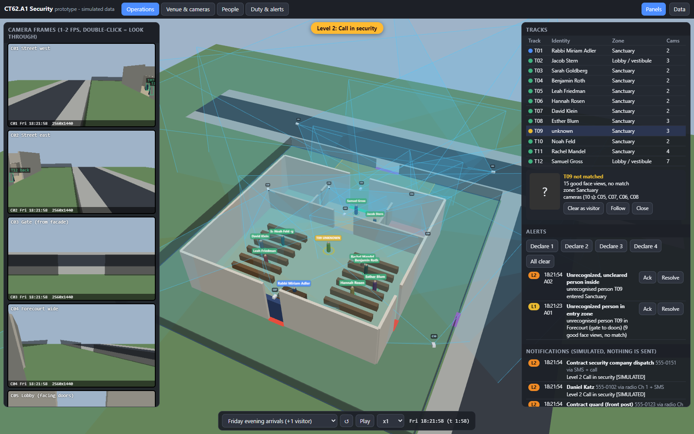
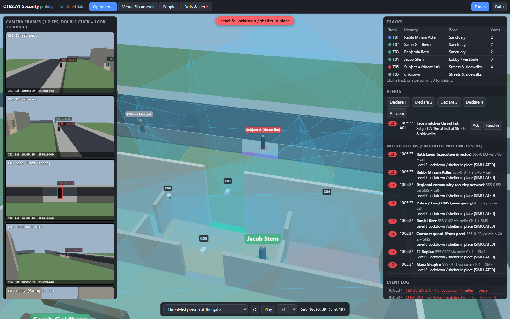
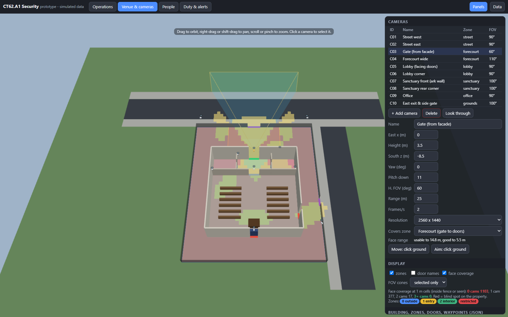
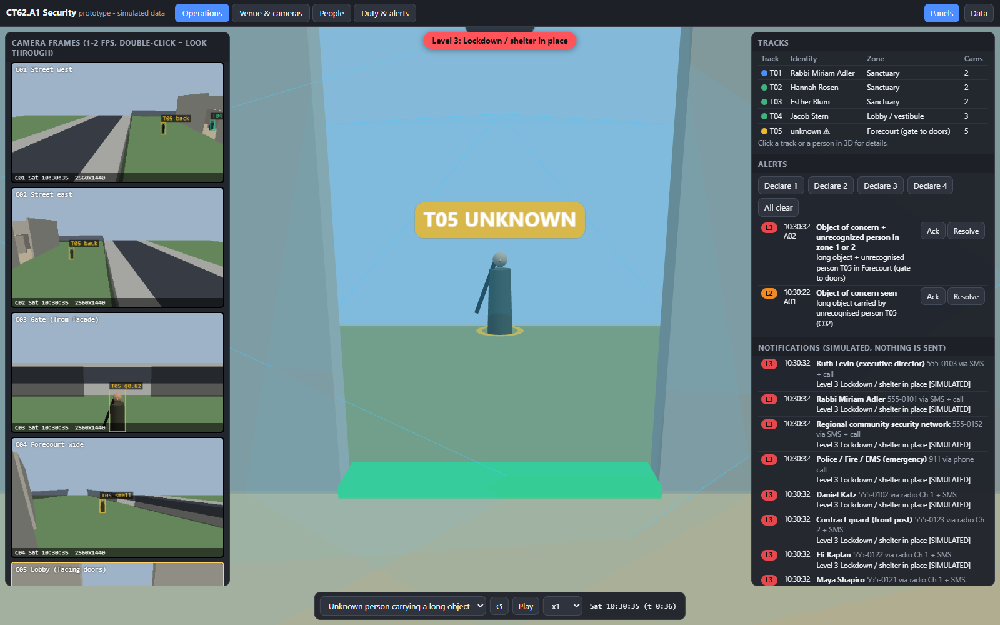
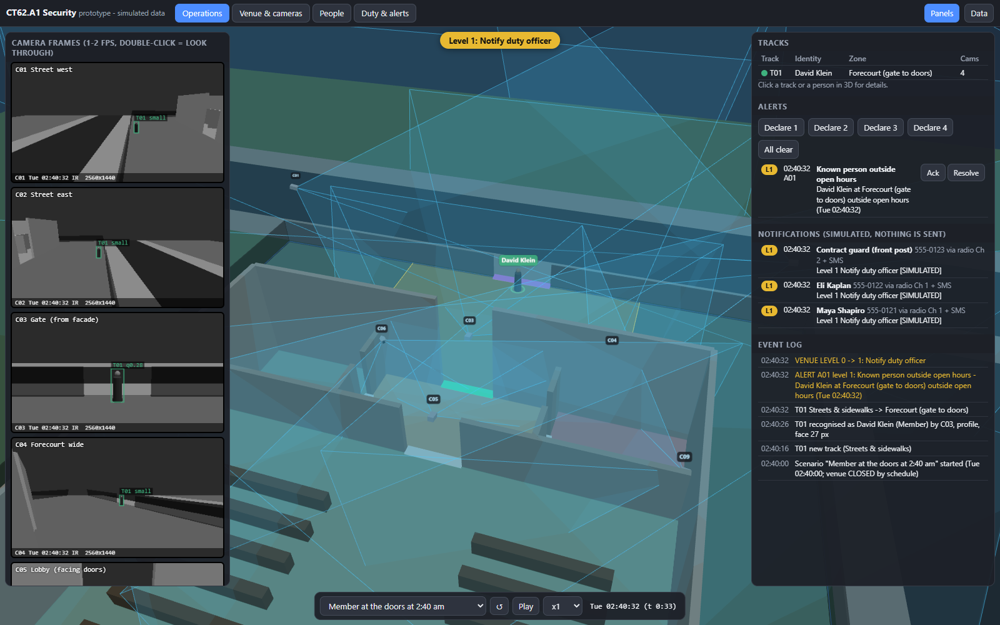
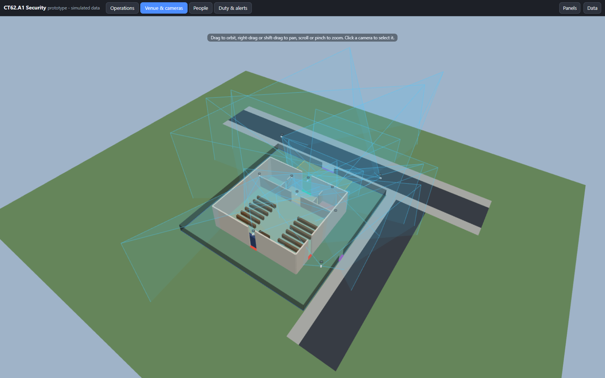
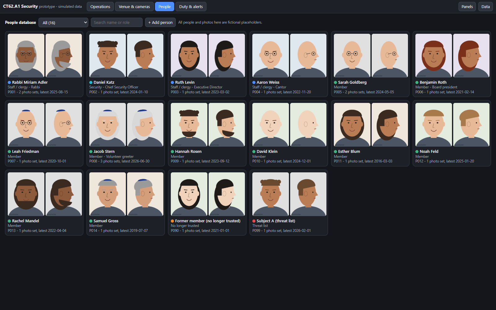
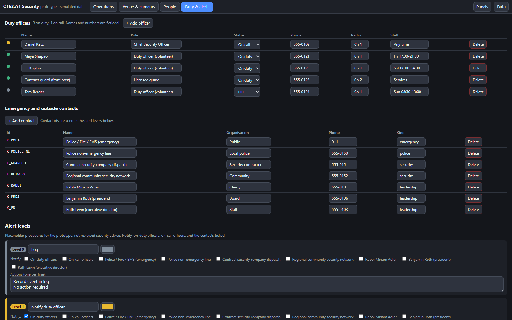

# CT62.A2 Security

**A2 (2026-11-13):** adds a front page. Opening `index.html` now shows the copyright and a notice that this is an
untested prototype, not yet a security system, and that cameras and test images are needed and welcome as
contributions. "Enter the prototype" closes it; the new **About** button in the top bar shows it again. The page is
skipped when `index.html` is opened with a query string (self-test, image capture). Nothing else changed from A1
(same data, same localStorage key `ct62a1.db`, so local edits carry over).

© 2026 Michael Wahrman. All rights reserved.

---


An experimental security console for a synagogue: venue and camera layout, a people database with photos, duty
officers and alert procedures, and a simulation of people arriving. Cameras take still frames at 1-2 fps, a stand-in
"recogniser" matches faces, and rules raise alert levels.

**Status: prototype (art-style rules, assumptions written down, strict rules to come later).** Everything here is
fictional: the building, the people, the phone numbers and the face pictures. No real face recognition is done and
nothing is sent to anyone. Notifications appear on screen marked *SIMULATED*.



## Running it

Open `index.html` in a browser (Chrome, Edge or Firefox). It works straight from disk. three.js r186 is bundled
in `lib/`, so nothing is downloaded.

To edit the JSON files and see the changes without rebuilding, serve the folder instead:

```bash
python3 -m http.server 8762
```

and open http://localhost:8762/. When the page is opened from disk it reads `data/bundle.js`. Rebuild that file after
editing `data/*.json`:

```bash
python3 scripts/bundle_data.py
```

The information panels are **off when the page opens** (so they don't cover the view on a phone). Press **Panels**
or the **P** key to show them.

## The four tabs

| Tab | What it does |
|---|---|
| Operations | Runs a scenario in 3D. Tiles for each camera show the frame it last took, with detection boxes (`MATCH`, quality `q0.82`, `back`, `small`). Also tracks with identity and zone, alerts (Ack / Resolve / Declare 1-4 / All clear), simulated notifications, and an event log. Click a person or track for details, **Clear as visitor** after a greeter has checked them, or **Follow**. Double-click a camera tile to look through that camera. |
| Venue & cameras | Camera list and editor (position, height, yaw, pitch, field of view, range, fps, resolution, zone). *Move* / *Aim* place a camera by clicking the ground. Shows FOV cones and a **face coverage map** (how many cameras get a usable face at each 1 m spot). The walls, zones, doors, streets and waypoints can be edited as JSON. |
| People | The recognition database: members, staff/clergy, security, *no longer trusted*, and *threat list* (which may be empty). Each person has front and side photos with a dated history, contact details, allowed zones, and access (open hours only, or any time). You can upload real photos (they are shrunk to 480 px). |
| Duty & alerts | Duty officers (on duty / on call / off), outside contacts, alert levels 0-4 with who is notified and the action list, the rules and which level each one raises, and the open hours. |

**Data** (top right) exports any of the five JSON files, imports them, or resets to the shipped data. Edits are kept
in this browser until you export them.

## Zones and alert levels

Zones: **0 outside** (streets, and the grounds inside the fence), **1 entry** (forecourt from the gate to the doors,
and the lobby), **2 interior** (sanctuary, classroom, and the office, which is marked *staff only*).

| Level | Name | Notifies (simulated) |
|---|---|---|
| 0 | Log | nobody |
| 1 | Notify duty officer | on-duty officers |
| 2 | Call in security | + on-call officers, security contractor |
| 3 | Lockdown / shelter in place | + 911, community security network, rabbi, executive director |
| 4 | Evacuate | + board president (only declared by the operator) |

Rules: threat-list match (3), *no longer trusted* match (2), unrecognised person in zone 1 for more than 8 s (1),
unrecognised and uncleared person inside (2), unrecognised person loitering outside for 240 s (1), known person
outside open hours (1), person in a zone they aren't allowed in (1), object of concern (2), and object plus an
unrecognised person in zone 1/2 (3). All of these are editable in `alerts.json` or on the Duty tab. They are
**placeholder procedures, not reviewed security advice.**

## Scenarios

| Scenario | What should happen |
|---|---|
| Friday evening arrivals (+1 visitor) | All 10 members and the rabbi are recognised; the visitor raises level 1, then level 2 (try *Clear as visitor*) |
| Threat-list person at the gate | Matched by the gate camera while they stop and look -> level 3 |
| Member at the doors at 2:40 am | Night (IR-style frames) -> level 1 *outside open hours* |
| Unknown person carrying a long object | Object level 2 -> object + unknown level 3 |
| Member walks into the staff office | Level 1 *wrong zone* |
| Loiterer across the street | Too far away for face matching -> level 1 loitering after 4 min (use x10) |
| 'No longer trusted' person arrives | Level 2 on match |



## How the simulated recogniser works

For each camera frame, each person is tested against the camera's view pyramid. Walls block the view (2-D line of
sight; walls are assumed taller than the cameras). The estimate is then:

- **face width in pixels** = 0.16 m / (2 x distance x tan(HFOV/2)) x horizontal resolution
- **pixel quality** = 0 below 24 px, rising to 1 at 64 px
- **angle quality** = 1 frontal (< 30 deg), 0.85 three-quarter (< 60), 0.6 profile (< 100; we hold side photos), 0 from behind
- an enrolled person is matched with probability 0.97 x pixel quality x angle quality. A person who is not enrolled
  is never matched (no false matches in A1).
- a carried object is noticed with probability 0.5 per frame once the person is 160 px or taller in the frame

One worked number: a 90 deg camera at 2560 px gives about 20 px of face at 10 m. That's too small to match, which is
why the street cameras catch passers-by but don't identify them.



**Finding from the sample layout:** with 10 cameras at 2560x1440, usable face coverage exists only along the entry
path (gate, forecourt, doors, lobby, sanctuary doors). No spot on the property is covered by 3 or more cameras, and
the seating area, the grounds and the classroom are blind spots for faces. Someone facing the ark from the bimah is
never identified, so the arrivals scenario has the rabbi walk in through the lobby. The coverage map is meant for
exactly this kind of planning.

## Assumptions (UNVERIFIED, to be checked before any real use)

1. **Face-size thresholds** (24 px usable, 64 px reliable, 0.16 m face width) are planning guesses. Real thresholds
   depend on the recognition model, lighting, motion blur, compression and lens distortion. Check them against the
   chosen camera and model.
2. **Wide-angle lenses** are modelled as plain perspective cameras. Barrel distortion and the drop in resolution at
   the edges are ignored.
3. **Tracking hand-off is perfect.** The same person keeps one track across all cameras, and the zone comes from their
   true position. In a real system, re-identification across cameras is a hard problem in its own right.
4. **No false matches, and no look-alikes.** Real systems have false-match and false-non-match rates that must be
   measured.
5. **Object detection** is a coin flip once the person is large enough in the frame. It is not a model of any real
   detector.
6. **Low light:** night frames are shown greyscale ("IR"), but recognition quality is not reduced at night.
7. **Frame timing:** each camera takes frames at its own fps with a fixed phase. There is no network delay and no
   lost frames.
8. **Procedures, notification lists and level names** are placeholders. They are not reviewed advice from police,
   security professionals or community security organisations.
9. **Privacy and law:** holding photos of members, and especially of people judged to be threats, raises
   biometric-privacy, consent and data-retention questions that differ by country and state. They have not been
   researched here and must be before real deployment.

## Files

```
index.html               the app (four tabs)
js/util.js store.js      helpers; the five JSON "databases" (localStorage edits + export/import)
js/faces.js              placeholder portrait drawings (front + profile)
js/scene.js              three.js venue, camera model + visibility test, coverage map, figures
js/sim.js                scenario runner, fake recogniser, tracks, rules, alert levels, notifications
js/ui_*.js main.js       the tabs
js/selftest.js           in-page tests (index.html?selftest=1)
data/*.json              venue, people, duty, alerts, scenarios  (+ bundle.js generated from them)
scripts/bundle_data.py   cross-reference check + build data/bundle.js
scripts/run_selftest.py  headless self-test -> docs/TEST_REPORT.md
scripts/capture_images.py headless screenshots -> images/
scripts/make_docs.py     .md -> .html shadows
lib/three.r186.min.js    three.js (MIT)
```

URL options (handy for links and screenshots): `?tab=ops|venue|people|duty&scenario=threat&t=40&play=0&panels=1&speed=10&cov=1&fov=sel&cam=C03&look=C05&sel=T09&fresh=1`

## Tests

```bash
python3 scripts/run_selftest.py
```

This runs the data check, 11 camera-model checks, and the 7 scenarios with 5 random seeds each (35 runs). See
[docs/TEST_REPORT.md](docs/TEST_REPORT.md). Last result: **PASS** (11/11 checks, 35/35 runs). These tests show the
program does what it was written to do. They do not show that real cameras or recognition would behave this way.

## More pictures






